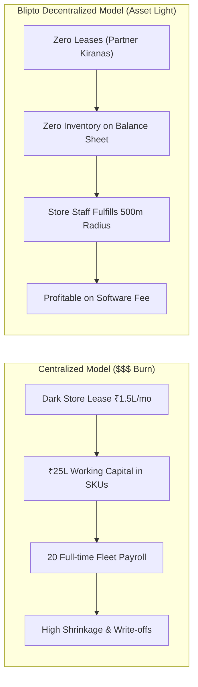

# 📊 Blipto: Unit Economics & Strategic Strategy Model

## Executive Summary
**Blipto** fundamentally alters the unit economics of quick commerce by transitioning from a capital-heavy **Inventory-Led Dark Store Model** (e.g., Zepto, Blinkit, Instamart) to a decentralized, asset-light **Merchant-Fulfilled Hyper-Local Network**.

---

## 1. Comparative Unit Economics: Blipto vs. Centralized Dark Stores

All figures modeled on an Average Order Value (AOV) of **₹400 ($4.80 USD)** within an urban Indian catchment area (500m – 2km radius).

| Cost / Revenue Line Item | Traditional Dark Store Model (Zepto/Blinkit) | Blipto Decentralized Model | Structural Advantage |
| :--- | :--- | :--- | :--- |
| **Average Order Value (AOV)** | ₹400 | ₹400 | Parity |
| **Gross Margin / Product Margin** | 18.0% (₹72) *(held in owned stock)* | 0% (Merchant owns stock) | **$0 Inventory Capital Risk** |
| **Blipto Platform Take-Rate** | N/A | **4.5% (₹18.00)** | Fair, transparent software fee |
| **Delivery Fee Charged to Consumer**| ₹15 – ₹35 (plus surge, night fees) | **₹0 – ₹15 flat** (Honest pricing) | Eliminates consumer churn & dark patterns |
| **Dark Store Lease & Amortization**| -₹24.00 per order (High CapEx) | **₹0.00** | Uses existing kirana real estate |
| **Dedicated Rider Payout / Fleet Payroll** | -₹48.00 per order | **-₹12.00 (Amortized store staff)** | Merchant utilizes idle in-house delivery boy |
| **Shrinkage, Spoilage & Damaged Stock** | -₹8.00 (2.0% of AOV) | **₹0.00 (Borne by merchant / zero transit)** | Shorter holding time; direct consumer pick |
| **Packaging & Warehousing Hub Ops** | -₹14.00 per order | **-₹2.50 (Store bag / eco packaging)** | No centralized sortation sorting hubs |
| **Payment Gateway & Tech Infrastructure** | -₹6.00 per order | **-₹3.50 per order** | Micro-payment routing / direct UPI rails |
| **Customer Acquisition Cost (CAC) Amortized**| -₹30.00 per order | **-₹6.00 per order** | High organic virality via neighborhood store loyalty |
| **Net Contribution Margin per Order (CM2)** | **-₹15.00 to -₹28.00 (Loss-making)** | **+₹8.00 to +₹12.00 (Positive from Day 1)** | **Positive Unit Economics** |

---

## 2. Capital Expenditure (CapEx) & Working Capital Efficiency

* **Breakeven Timeline:** Traditional dark stores take 18–36 months to achieve store-level EBITDA parity; Blipto stores achieve positive unit contribution on day 1 because fixed costs are already covered by the store's physical walk-in retail operations.
* **Working Capital Velocity:** Kiranas turn over working capital 18–24 times annually. By replacing informal delayed customer credit (*udhari*) with immediate digital escrow payouts upon delivery, Blipto injects liquid cash into merchant balance sheets.

---

## 3. Bottleneck Analysis & Strategic Safeguards

| Operational Bottleneck | Root Cause | Blipto Architectural Countermeasure |
| :--- | :--- | :--- |
| **Merchant Delivery Fatigue** | Heavy rain or in-store customer rush overwhelms internal boy. | **Dynamic Peak-Load Spillover Engine:** Automatically routes overflow orders to partner stores within 1.2km; triggers "Busy Mode" buffer. |
| **Phantom Stockouts** | In-store customer buys the last milk carton before app order is packed. | **Continuous Barcode Scan + Safety Buffer:** High-velocity SKUs flag low-stock threshold ($N \le 1$) and drop from public listing. |
| **Dispute & Fraud Risk** | False claims of non-delivery or bad produce. | **Zero-Human Escrow System:** Geotagged delivery photo/OTP verification at handoff + mandatory customer defect photo within 15 mins. Automated 3-strike de-platforming. |
| **Catalog Onboarding Friction** | Retailers lack time to manually type 2,000 SKUs. | **Global Barcode Database:** Scanning an EAN-13 barcode auto-populates title, brand, category, and standard image; retailer only enters price and stock. |
