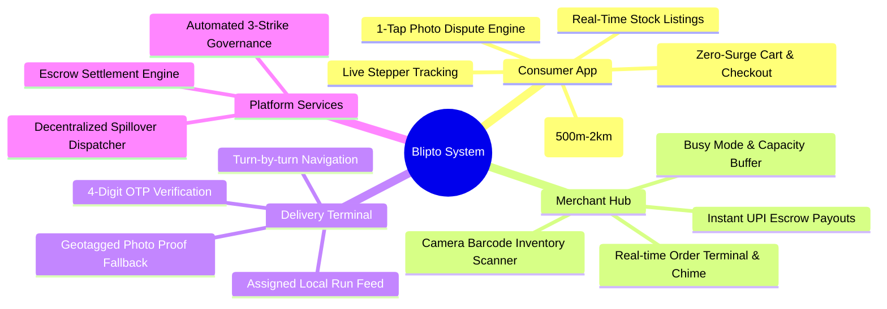

# 🌐 Blipto: System Scope Document (SSD)

## 1. System In-Scope Capabilities (v1.0 MVP)

---

## 2. System Out-of-Scope (Future Iterations)
1. **Centralized Warehousing / Cold-chain:** Blipto will never own or lease physical warehouses.
2. **Dedicated Platform Delivery Fleets:** All fulfillment runs strictly through participating store staff or vetted neighborhood micro-couriers.
3. **Regional / Inter-city Shipping:** Orders are strictly limited to a hyper-local maximum radius of 2.5 kilometers.
4. **Desktop POS Hardware Requirements:** The entire system must function 100% on standard Android smartphones without dedicated thermal printers or barcode guns.
